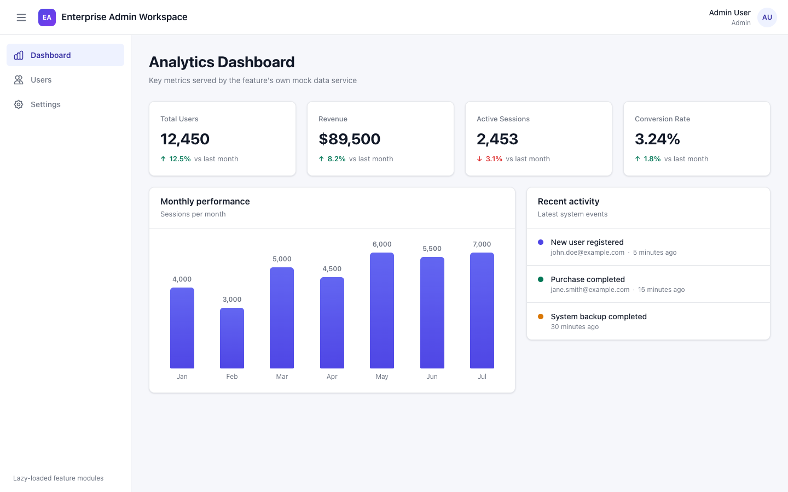
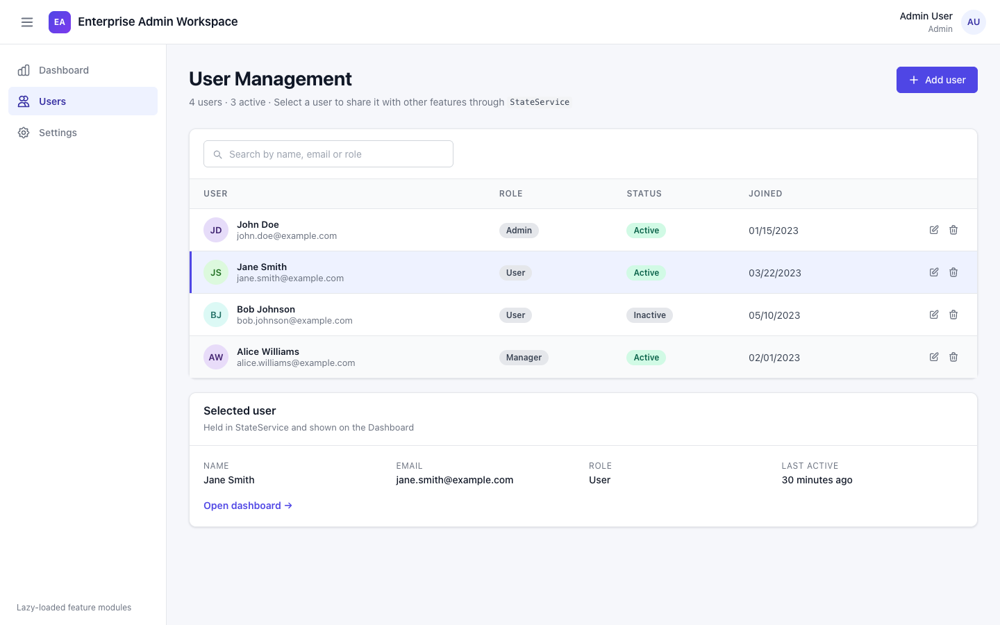
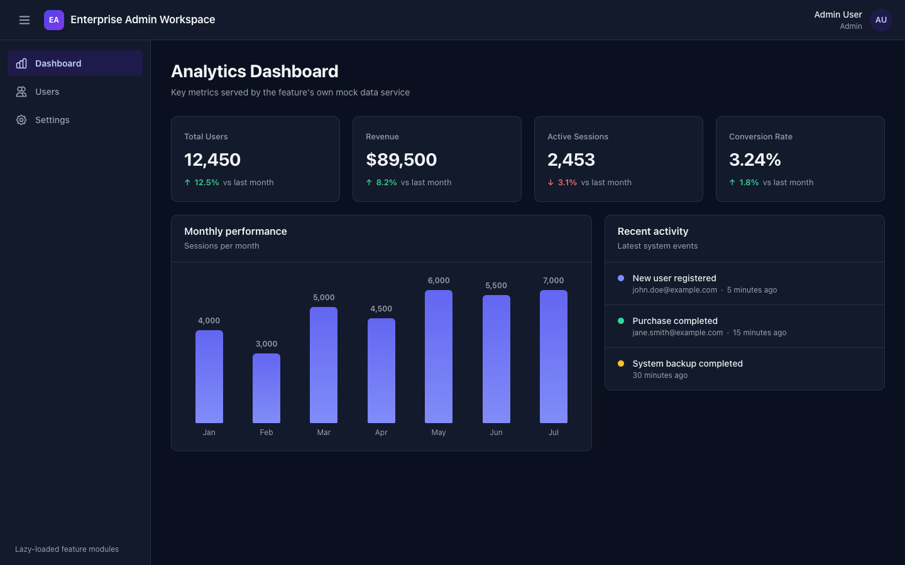
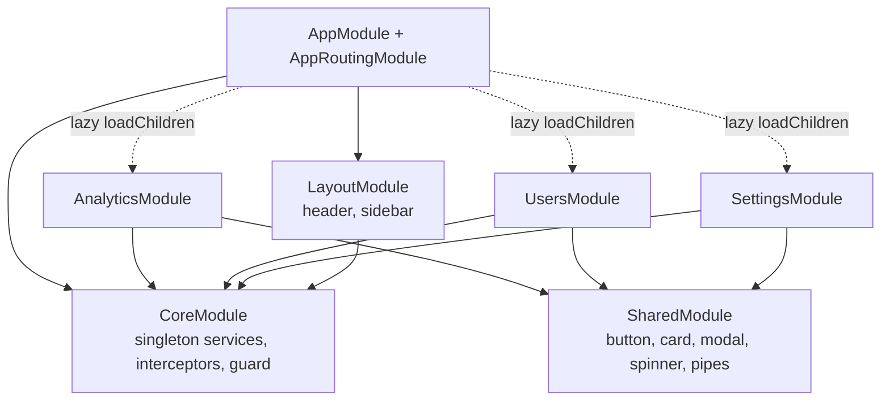

# Modular Angular Architecture Blueprint

A small but complete Angular admin app (dashboard, user management, settings) built to show how to structure a growing Angular codebase: a singleton core layer, a reusable shared layer, and lazy-loaded feature modules that never import each other.

[](https://github.com/kashish14/Modular-Angular-Architecture-Blueprint/actions/workflows/ci.yml)
[](https://angular.dev/)
[](https://www.typescriptlang.org/)
[](https://rxjs.dev/)
[](LICENSE)



| User management | Dark theme |
|---|---|
|  |  |

## Features

- **Dashboard**: metric cards, a monthly bar chart and an activity feed. It also shows the user currently selected on the Users page, read from shared state.
- **User management**: list, search, add, edit and delete users, with form validation, a delete confirmation dialog, and loading and empty states.
- **Settings**: dark mode, two other preferences, language and timezone (with a live date preview). Changes are saved to `localStorage` and broadcast on the event bus.
- **App shell**: header, a sidebar that collapses to an icon rail on desktop and becomes a drawer on mobile, a skip link, and keyboard-accessible dialogs (Escape to close, focus moves into the dialog and back out).
- **No backend needed**: every feature uses an in-memory mock service with simulated latency.

## Tech stack

| Area | Choice |
|---|---|
| Framework | Angular 21, NgModule-based (`standalone: false`), new control flow (`@if`, `@for`) |
| Language | TypeScript 5.9 in strict mode with strict templates |
| State | RxJS `BehaviorSubject` services (no NgRx) |
| Styling | SCSS, with CSS custom-property design tokens for light and dark themes |
| Build | Angular CLI `@angular/build:application` (esbuild) |
| Tests | Jasmine + Karma (headless Chrome), plus a Node script that checks module boundaries |
| CI | GitHub Actions on Node 22: boundary check, build, tests |

## Architecture



**Layer rules.** Features may import `core` and `shared`. `core` imports nothing from the other layers, `shared` imports nothing from features or layout, and no feature imports another feature. `npm run check:boundaries` enforces these rules, and CI runs it.

**What each layer contains:**

- `core/`: provided once. It holds `AuthService` (mock login), `StateService` (shared state), `EventBusService` (typed pub/sub), `ThemeService`, `LoggerService`, `ApiService` (a thin `HttpClient` wrapper), the HTTP interceptors and `authGuard`. `CoreModule` throws if it is imported twice.
- `shared/`: presentational building blocks with no business logic: `app-button`, `app-card`, `app-modal`, `app-loading-spinner`, and the `dateFormat` and `truncate` pipes.
- `features/*`: each feature has its own routing module, components, models and a service provided at the feature level. Every feature is a separate lazy chunk.

**How features talk to each other without imports:**

| Mechanism | Example in this repo |
|---|---|
| Shared state (`StateService`) | Selecting a user on **Users** stores it in `StateService.selectedUser$`, and the **Dashboard** banner reads it from there. |
| Event bus (`EventBusService`) | **Settings** emits `SETTINGS_CHANGED`. The core `ThemeService` listens for it and switches the theme for the whole app. |
| Router | Links such as "Open dashboard" on the selected-user card. |

**Routing and the guard.** `/dashboard`, `/users` and `/settings` are lazy routes protected by a functional `canMatch` guard (`authGuard`). There is no login screen, so the guard signs in the mock demo account before the feature chunk is matched. Unknown paths redirect to `/dashboard`.

**HTTP.** `AuthInterceptor` adds `Authorization: Bearer <token>` when a token is stored, and `ErrorInterceptor` logs failures and turns them into a single `Error` message format. Both are registered with `provideHttpClient(withInterceptorsFromDi())` and have unit tests. The demo features use in-memory data, so the running app makes no HTTP calls. To use a real backend, call `ApiService` from a feature service instead.

The [`docs/`](docs) folder covers the reasoning in more depth:

- [architecture overview](docs/architecture-overview.md)
- [module strategy](docs/module-strategy.md)
- [dependency management](docs/dependency-management.md)
- [decision log](docs/decision-log.md)
- [testing strategy](docs/testing-strategy.md)
- [module federation](docs/module-federation.md): a design guide only, not implemented here

## Getting started

Prerequisites: Node.js 20.19+, 22.12+ or 24+, and npm.

```bash
git clone https://github.com/kashish14/Modular-Angular-Architecture-Blueprint.git
cd Modular-Angular-Architecture-Blueprint
npm ci
npm start
```

Then open http://localhost:4200. You are signed in automatically as the demo admin.

## Scripts

| Command | What it does |
|---|---|
| `npm start` | Dev server on port 4200 with live reload |
| `npm run build` | Production build into `dist/enterprise-admin-workspace/browser` |
| `npm run watch` | Development build in watch mode |
| `npm test` | Karma in watch mode (opens Chrome) |
| `npm run test:ci` | Single headless test run (needs a local Chrome or Chromium) |
| `npm run check:boundaries` | Fails if an import breaks the layer rules above |

## Project structure

```
src/app/
├── core/                 # singletons: services, interceptors, guard, models, config
├── shared/               # reusable UI components and pipes (SharedModule)
├── layout/               # header and sidebar (LayoutModule)
├── features/
│   ├── analytics/        # dashboard      (lazy: /dashboard)
│   ├── users/            # user CRUD      (lazy: /users)
│   └── settings/         # preferences    (lazy: /settings)
├── app-routing.module.ts # lazy routes + canMatch guard
└── app.module.ts
scripts/check-boundaries.mjs  # layer-rule checker
docs/                         # architecture write-ups and screenshots
```

To add a feature, create `features/<name>/` containing a `<name>.module.ts` and a `<name>-routing.module.ts`. Then add one `loadChildren` route in `app-routing.module.ts` and one sidebar link. You don't need to change any existing feature.

## Testing

```bash
npm run test:ci
npm run check:boundaries
```

The 23 unit tests cover:

- auth (login, logout, token storage)
- both interceptors, using `HttpTestingController`
- `ThemeService` reacting to the event bus
- `UsersService` CRUD, and that it writes to shared state and the event bus
- the dashboard component
- the app shell, including the sidebar toggle

## License

[MIT](LICENSE) © 2026 Kashish Agarwal
